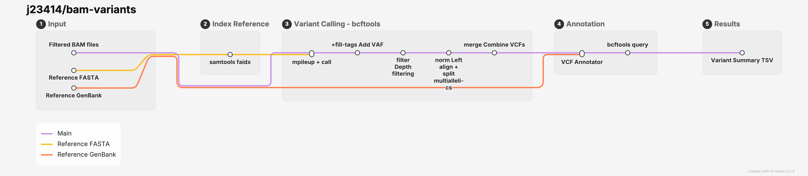

# bam-variants

A modular workflow for generating a table of variants from alignment information.



## Usage

```bash
# Run with defaults
nextflow run j23414/bam-variants \
  --samplesheet samplesheet.csv \
  --reference_fasta reference.fasta \
  --reference_gb reference.gb \
  -profile stjude

# Specify more details
nextflow run j23414/bam-variants \
  --samplesheet samplesheet.csv \
  --reference_fasta reference.fasta \
  --reference_gb reference.gb \
  --depth 100000 \
  --min_depth 100 \
  --bcftools_mpileup_args "--max-depth 10000 --max-idepth 10000 --per-sample-mF --count-orphans --no-BAQ --min-BQ 13 --min-MQ 30 --annotate AD,ADF,ADR,DP,SP" \
  --bcftools_call_args "-mv --prior-freqs AN,AC, -A --variants-only --keep-alts --keep-masked-ref" \
  --bcftools_filter_args "-i 'FORMAT/DP>=20' --output-type z --write-index=tbi" \
  --bcftools_norm_args "--multiallelics -any --check-ref s --output-type z --write-index=tbi" \
  -profile stjude
```

Example Nextflow progress messages

```bash
 N E X T F L O W   ~  version 26.10.2

Launching `bam-variants/main.nf` [golden_carson] revision: 48ddf33075
executor >  lsf (441)
[93/ffbc25] SAM…OLS_FAIDX (references.fna) | 1 of 1 ✔
[92/1e0c26] BCF…LL (SRX3234152_SRR6121597) | 109 of 109 ✔
[cb/188b4c] BCF…GS (SRX3234152_SRR6121597) | 109 of 109 ✔
[95/23f955] BCF…SRX3234152_SRR6121597_100) | 109 of 109 ✔
[3b/479a06] BCF…RM (SRX3234152_SRR6121597) | 109 of 109 ✔
[82/acc998] BCFTOOLS_MERGE (merged)        | 1 of 1 ✔
[6b/2f5c58] VCF_ANNOTATOR (annotate)       | 1 of 1 ✔
[6b/097f2d] BCFTOOLS_QUERY (1)             | 1 of 1 ✔
[13/0c0774] PIVOT_VARIANTS (1)             | 1 of 1 ✔
Completed at: 02-Nov-2026 22:46:09
Duration    : 10m 2s
CPU hours   : 24.4
Succeeded   : 441
```

Final variants in:

```bash
ls variant-results/sample_variants_results.tsv
ls variant-results/sample_variants_results_longer.tsv
```
